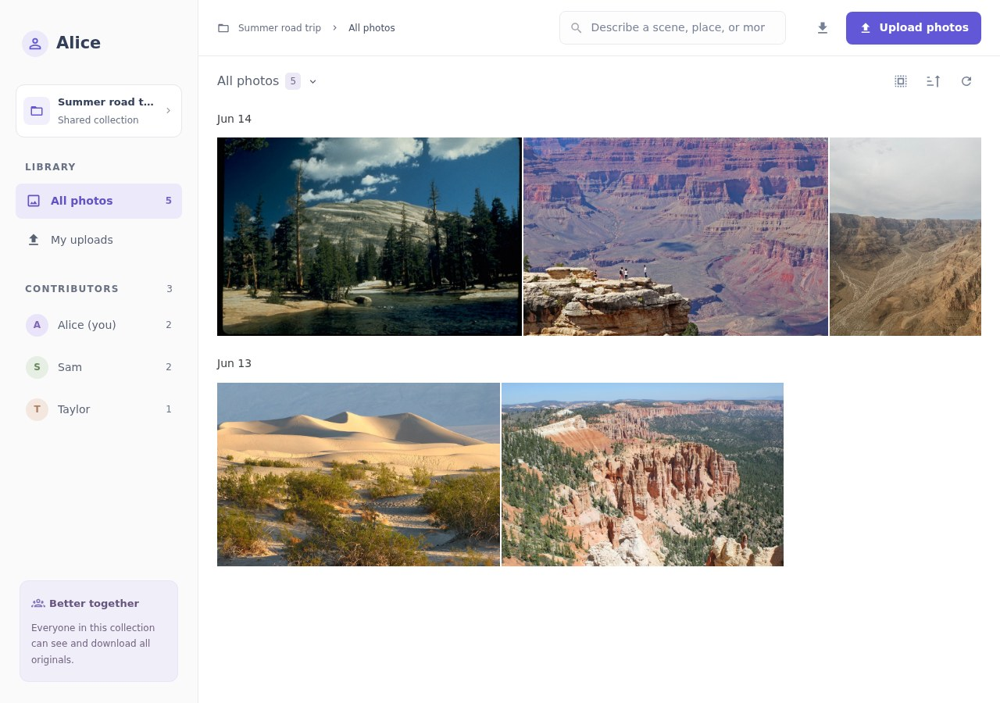
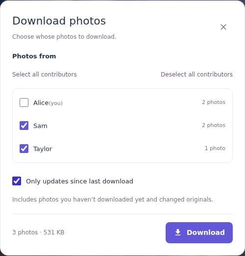
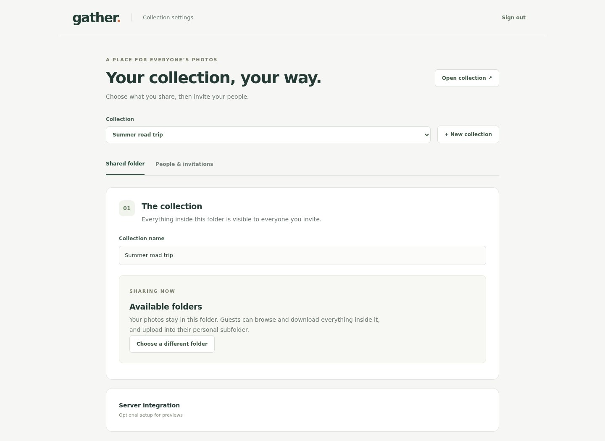

# Gather

Self-hosted photo sharing based on immich. Similar to Google Photos Album sharing but storing original files on a server of your choice and separating contributors.

Everyone adds their photos to one collection and downloads the photos they want. Your files stay in ordinary folders; [Immich](https://immich.app/) supplies previews and search.



- **Share a link.** Friends enter their name and claim a personal upload folder.
- **Keep your originals.** Duplicate files are detected before uploading; interrupted uploads resume.
- **Find a moment.** Search by description, people, dates, location, and camera details through Immich.
- **Download your picks.** Choose contributors, exclude yourself, or get only new and changed photos.
- **Bring photos in.** Upload from your device or import a shared Google Photos album.
- **Manage it in the browser.** Choose folders, create collections, and manage invitations at `/admin`.

| Download options | Collection administration |
| --- | --- |
|  |  |

Screenshots use a demo collection with [public-domain photography](docs/screenshots/README.md).

## Get started

Requires Docker Compose and a directory containing the photos you want to share. Connect an existing Immich instance for thumbnails, face filters, and semantic search.

```bash
git clone git@github.com:nielstron/gather.git
cd gather
cp .env.example .env
```

Set these values in `.env` (create the directories and give the container user write access):

```dotenv
ORIGIN=https://photos.example.com
COOKIE_SECURE=true
GATHER_FOLDER_ROOT=/srv/photos
GATHER_DATA=/srv/gather/data
```

```bash
docker compose up -d --build
```

Put an HTTPS reverse proxy in front of `127.0.0.1:3000`. Open `/admin`, use the private setup token from `GATHER_DATA/admin-setup-token` to create the administrator, then choose a collection folder and create a sharing link. Routine configuration happens in the UI.

See the [setup guide](docs/setup.md) for permissions, Immich configuration, URL prefixes such as `/gather`, and backups. Uploads and original downloads also work before Immich is connected.

## Using Gather

Everyone with a collection link can view and download its photos. Names are unique within a collection, ignoring capitalization; entering an existing name with a valid link reuses that contributor. This is designed for trusted groups, with no per-person viewing restrictions.

Keep the upload tab open and visible until transfers finish. Uploads can resume after returning, but phones may suspend background tabs. Link imports run on the server and continue after the tab closes.

[Usage guide](docs/usage.md) · [Immich folder-scan extension](integrations/immich/README.md)

## Development

Requires Node 22.17+.

```bash
npm ci
cp .env.example .env
npm run dev
```

Run `npm run check`, `npm test`, and `npm run test:e2e` before contributing. Browser tests use isolated fixtures and a mock Immich server. This is an early project intended for one Node process and small groups.
